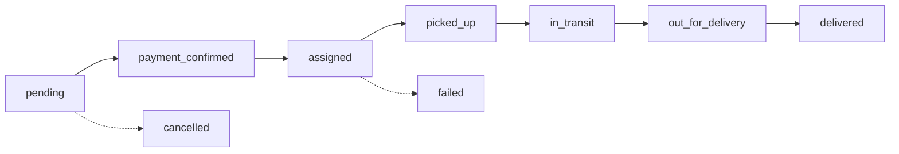

A shipment is created `pending` and carries no rider. What happens next depends on which of the
two fulfilment paths it is on.

## Courier assignment

When the quote came from a courier company, that courier owns the shipment. Its staff assign one
of their own riders, and the shipment moves to `assigned`. A rider from a different company cannot
be assigned to it — the check is on the courier company that owns the shipment, not on who is
asking.

## The on-demand offer round

On-demand shipments have no assigned courier. Instead, nearby independent drivers are offered the
job and the first to accept it takes it.

Candidates are narrowed by proximity — the hex-grid search described in
[Geography & Distance](/tldp/how-tldp-works/geography) — then ranked by true distance, and the closest
few receive a time-limited offer. Each offer names the fare and the distance, so a driver accepts
a known job rather than a blind one.

Acceptance is first-come, and settled under a row lock so a tie cannot produce two winners:

<Steps>
  <Step title="The offer is locked and checked">
    An offer that has already been answered, or whose window has passed, is refused.
  </Step>
  <Step title="The shipment is re-checked">
    If it has picked up a rider in the meantime, the offer is marked expired rather than honoured.
    This is the case that makes a race safe: the second driver is told the job is gone, not given
    a shipment somebody else is already carrying.
  </Step>
  <Step title="The winner is recorded">
    The offer is accepted, every other outstanding offer on that shipment is expired in the same
    transaction, and the shipment moves to `assigned` with the driver attached.
  </Step>
</Steps>

For a driver already travelling a route, an offer can be matched against the direction of travel
rather than proximity alone, so a job is offered to someone whose journey already passes through
the pickup and drop-off corridor.

## The status ladder

Both paths converge on one sequence. A shipment moves forward through it, and each transition
writes a timestamped event that appears in tracking.

<Frame>

</Frame>

Only the courier holding the shipment, one of its staff, or the assigned rider may advance it.
Delivery is the state that settles things: it records the delivery against the courier's service
level, and it closes out what the courier owes the platform on that shipment.

An order tracks the shipment fulfilling it, so an order moves to `in_delivery` once the parcel is
on its way and to `delivered` when it arrives, without a separate call.

## Proof of delivery

Delivery is evidenced rather than asserted. A shipment carries the kind of proof it requires — a
photograph, a one-time code given to the recipient, or a signature — and the proof is recorded
against the shipment at the point of delivery, with the rider identified. A delivery attempt that
cannot produce the required proof is not a delivery.
