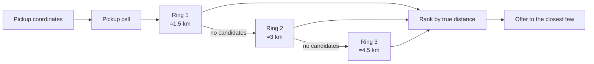

Three different questions about distance run through the platform, and each is answered with the
tool that fits it: how far apart two points are, which fixed location is closest to a customer,
and which drivers are near enough to be worth offering a job.

## Distance between two points

Point-to-point distance uses the great-circle distance on a sphere of radius 6,371 km — the mean
radius of the Earth:

```
d = R · arccos( sin φ₁ · sin φ₂ + cos φ₁ · cos φ₂ · cos(λ₂ − λ₁) )
```

where φ is latitude and λ is longitude, both in radians, and `R = 6371`. The result is rounded to
two decimal places and expressed in kilometres.

The argument to `arccos` is clamped to the interval [−1, 1] before it is evaluated. Floating-point
rounding can push it a fraction beyond either end for two points that are nearly identical or
nearly antipodal, and an unclamped `arccos` is undefined there. Clamping makes the distance
between a point and itself resolve to exactly zero rather than an error.

This is a straight-line distance over the ground. It does not follow roads, so a road journey is
always at least as long. It is used where a consistent, cheap, symmetric measure is what matters —
ranking candidates, computing an on-demand fare, checking a delivery radius — not for turn-by-turn
estimates.

<Note>
Distance from a point to an **area** is a different calculation. A zone boundary is a polygon, and
the distance from a destination to that boundary is measured to the nearest edge of the shape.
That is the distance the door-delivery overage in [Pricing](/tldp/how-tldp-works/pricing) is billed on.
</Note>

## Finding the nearest pickup point

A shipment can be routed to a pickup point instead of a door. Given the customer's coordinates,
the platform ranks every active pickup point belonging to an active courier by distance and
returns the closest, each annotated with its own `distance_km`. The search can be narrowed to a
single courier when the courier has already been chosen.

The ranking is exhaustive rather than clever: distance is computed for every candidate and the
list is sorted. Pickup points number in the tens per city, so the direct comparison is both exact
and immediate — an index that only approximates proximity would add failure modes without saving
measurable time at this size. Delivery stations, which serve the same purpose on the inbound leg,
are ranked identically.

## Narrowing a driver search with a hex grid

Dispatch asks a different question. Ranking every driver in a city against every job does not hold
up as the pool grows, and most of those drivers are too far away to be worth measuring.

Coordinates are therefore indexed onto a hexagonal grid, at a resolution where one cell covers
roughly 0.74 km² — a little under a kilometre across. Each driver's current position is stored as a cell
identifier, and each shipment's pickup and drop-off are stored the same way. Finding candidates
becomes a lookup of drivers whose cell is in a set, which an index answers directly.

<Frame>

</Frame>

The search starts with the cells immediately surrounding the pickup and widens only if that ring
turns up nobody, stepping out to roughly 3 km and then 4.5 km. Hexagons are used rather than
squares because every neighbour of a hexagon shares an edge and sits the same distance away,
so a ring is a consistent band of distance in all directions.

The grid narrows the field; it does not decide the outcome. Whoever survives the ring search is
then ranked by true great-circle distance, and the closest few are offered the job. A cell is a
coarse index over a fine measurement, which is why a driver just across a cell boundary is never
excluded by the grid alone.

Because the grid is only an index, it never appears in the API. Coordinates go in, offers and
distances come out.
