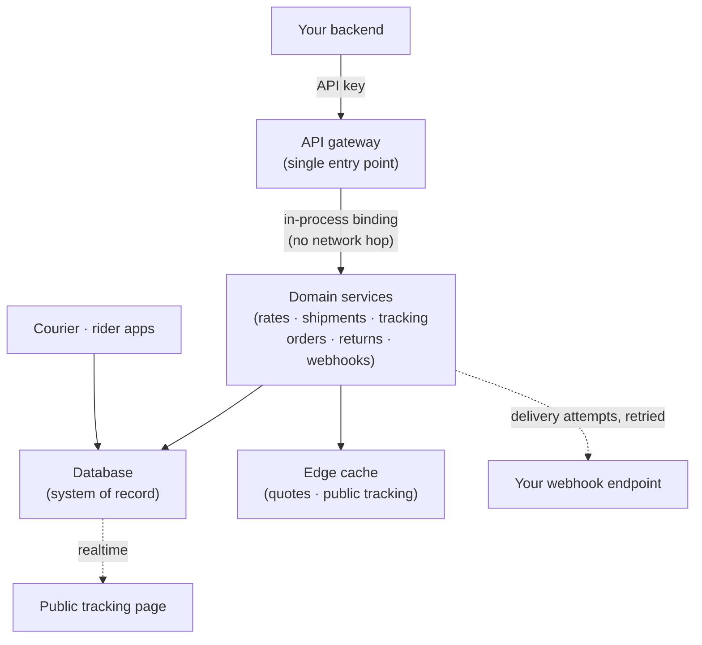

TLDP puts one API in front of many courier companies. A rate request is priced against every
courier that covers the route and returns a quote from each; accepting one creates a shipment
that the chosen courier fulfils. The platform holds the shared parts — pricing, quoting,
dispatch, tracking, proof of delivery, returns — so an integration writes them once instead of
once per courier.

Keys, environments, and the conventions that hold across every endpoint are covered in
[Authentication](/tldp/authentication).

## The shape of the system

<Frame>

</Frame>

Every request enters through one gateway, which routes it to the service that owns its domain and
strips nothing else along the way. Services are stateless: they authenticate the key, apply the
caller's rate limit, and hand the work to the database, where the pricing and fulfilment logic
lives. Putting that logic in the database rather than in the service is what makes a shipment
creation atomic — the quote is consumed, the shipment is written, and the payment record is
created in one transaction that either all happens or none of it does.

The database is the system of record. Caches and the public tracking page are derived from it.

## Two ways a delivery is fulfilled

A shipment is carried either by a **courier company**, which assigns one of its own riders, or by
the **on-demand pool**, where independent drivers are offered the job and the first to accept it
takes it. The two share a shipment lifecycle and a tracking surface, and differ in how a carrier
is chosen and how the fare is computed.

<CardGroup cols={2}>
  <Card title="Pricing & Rate Quotes" icon="calculator" href="/tldp/how-tldp-works/pricing">
    Weight brackets, zone blocks, and the distance overage on a door delivery.
  </Card>
  <Card title="Geography & Distance" icon="location-dot" href="/tldp/how-tldp-works/geography">
    The distance formula, how the nearest pickup point is found, and hex-cell dispatch.
  </Card>
  <Card title="Request Lifecycle" icon="route" href="/tldp/how-tldp-works/request-lifecycle">
    A quote, a shipment, and a tracking read, step by step.
  </Card>
  <Card title="Dispatch & Fulfilment" icon="truck-fast" href="/tldp/how-tldp-works/dispatch">
    Assignment, the on-demand offer round, and the shipment status ladder.
  </Card>
  <Card title="Caching & Resilience" icon="layer-group" href="/tldp/how-tldp-works/caching">
    What is cached, revalidation, rate limits, and idempotent retries.
  </Card>
  <Card title="Returns & Reverse Logistics" icon="rotate-left" href="/tldp/how-tldp-works/returns">
    The return lifecycle, liability, and the reverse shipment.
  </Card>
</CardGroup>
