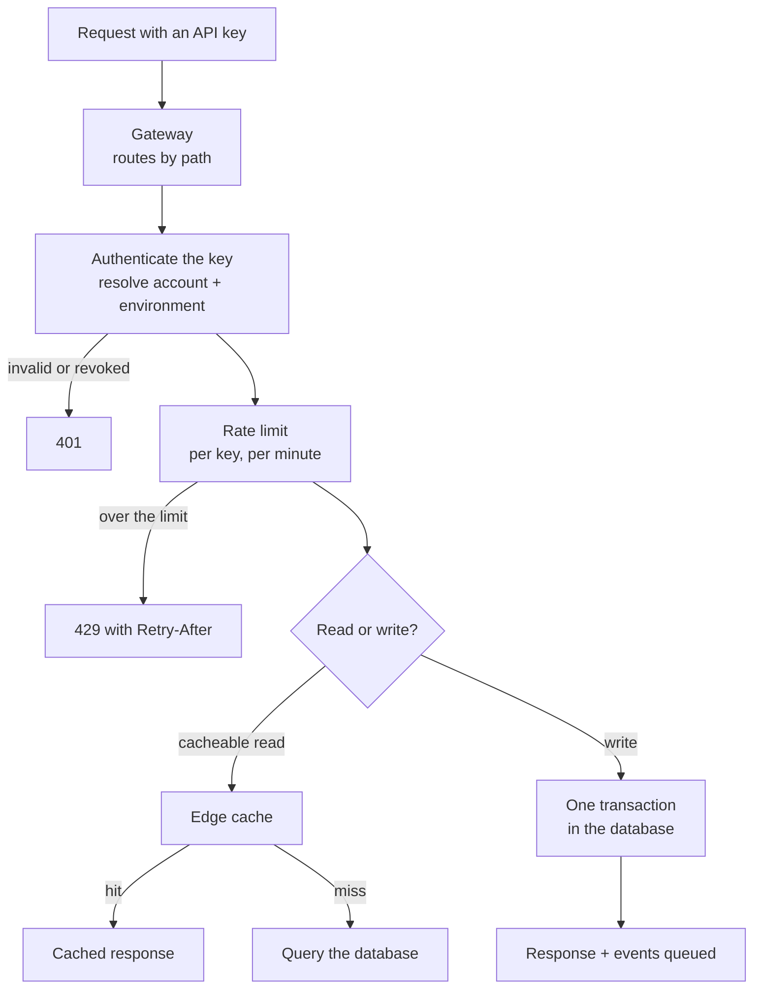

Every request follows the same path to the service that owns it, and only then diverges by what it
is asking for. A read may never reach the database; a write always does, and does so exactly once.

## The path in

<Frame>

</Frame>

The key is resolved first. It identifies the account, and it also determines the environment —
a test key sees only test data and a live key only live data, an isolation enforced when the data
is read rather than by the caller asking for it. A revoked key fails here, before any work.

Rate limiting runs next, per key. Every response carries the remaining allowance in its headers —
`X-RateLimit-Limit`, `X-RateLimit-Remaining`, and `X-RateLimit-Reset` as the epoch second the
window resets. A request over the limit is refused with `429`, and its body carries `retry_after`
in seconds. Limits are covered in [Caching & Resilience](/tldp/how-tldp-works/caching).

## A rate request

A rate request is priced against every courier covering the route, and each quote is stored with
an expiry before the response is returned. The stored quote is what makes the price binding: the
shipment is later created from the quote, not from a fresh calculation.

## Creating a shipment

Creating a shipment is a single transaction. It consumes the quote, writes the shipment with the
price the quote fixed, records the payment intent, and stamps a tracking number. If any part
fails, none of it is applied — there is no state in which a shipment exists at a price that was
never quoted, or a quote is consumed without a shipment.

<Steps>
  <Step title="The quote is validated">
    An expired quote, or one already used, is refused. This is a `400` naming the reason rather
    than a silently recalculated price.
  </Step>
  <Step title="The recipient is checked">
    A delivery needs a name, a phone number and an address. A request missing any of them is
    refused with a `400` naming the fields, before the transaction opens.
  </Step>
  <Step title="The shipment is written">
    Priced from the quote, assigned a tracking number, and left `pending` until a carrier takes it.
  </Step>
  <Step title="Events are queued">
    Webhook deliveries are queued as part of the same transaction, so an event is never emitted
    for a shipment that was not created.
  </Step>
</Steps>

## Retrying a write safely

Network failures make retries unavoidable, and a retried shipment creation must not create a
second shipment. Send an `Idempotency-Key` header with the request and the key is recorded with
the shipment it produced.

A repeat of the same key returns the **original shipment**, unchanged, with status `200` instead
of the `201` the first call returned. The status is the only difference; the body is identical, so
a client that does not distinguish them still behaves correctly. A retry arriving while the first
attempt is still in flight is told to retry rather than being allowed to race it.

<Note>
The status code is how you tell a creation from a replay: `201` means this call created the
shipment, `200` means an earlier call with the same key did.
</Note>

## Reading tracking

Tracking is readable two ways. The authenticated endpoint returns the full timeline — a timestamp
for each state the shipment has entered, null for those it has not — together with every scan
event in chronological order.

The public tracking page needs no key. It is keyed on the tracking number alone, returns a reduced
set of fields, and is rate limited per client address rather than per account, since there is no
account to attribute it to. It is the surface a recipient sees, so it is cached briefly and
updates as the shipment moves.
