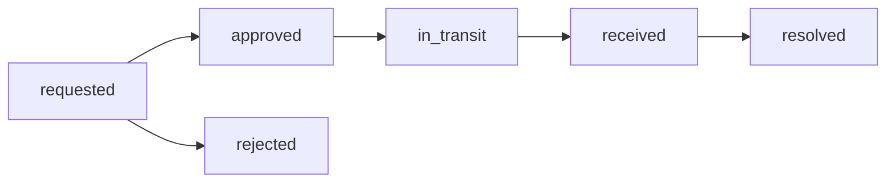

A return runs a delivery backwards. The parcel travels from the customer to the merchant, and at
the end of it either money moves or a replacement goes out. The platform models both the movement
and the settlement, because the two have to agree.

## The policy comes first

Each merchant sets the policy a return is judged against: whether returns are accepted at all, how
many days after delivery one may be raised, which reasons are acceptable, and which resolutions
are offered. A request outside that policy is refused when it is raised rather than at the end.

A return can only be raised against a **delivered** order. Until the parcel has arrived there is
nothing to return, and the delivery date is what starts the return window.

## The lifecycle

<Frame>

</Frame>

<Steps>
  <Step title="Requested">
    The customer names a reason and the items concerned. The reason is checked against the
    merchant's accepted list, and the request is refused if the window has passed.
  </Step>
  <Step title="Approved or rejected">
    The merchant decides, and chooses the resolution when approving. Approval creates the reverse
    shipment in the same step.
  </Step>
  <Step title="In transit and received">
    The reverse shipment is tracked like any other, and the merchant marks the goods received
    when they arrive.
  </Step>
  <Step title="Resolved">
    The refund is calculated, or the replacement is dispatched, and the ledger is adjusted.
  </Step>
</Steps>

Approving a return creates a **reverse shipment**: a real shipment with the addresses swapped, so
the customer becomes the origin and the merchant the destination. It is flagged as reverse and
linked to the return, which is what keeps a return leg out of forward delivery statistics.

## The reason decides who pays

A refund is not simply deducted from whoever is nearest. The reason a return was raised maps to
the party responsible for it, and that mapping is part of the merchant's policy:

| Reason | Bears the cost |
|---|---|
| Damaged in transit | Courier |
| Defective | Merchant |
| Wrong item | Merchant |
| Not as described | Merchant |
| Changed mind | Customer |

When a refund is resolved, the amount is reversed against the responsible party in proportion to
what they were originally credited, and recorded as a negative entry rather than by editing the
original. The ledger keeps both the original earning and its reversal, so a settled shipment that
is later refunded remains auditable — the history shows what was earned and what was taken back,
not a number quietly rewritten.

Damage in transit reverses the courier's share, and the rider's share with it. A change of mind
does not: the goods were as described and delivered correctly, so the delivery is still owed.

## Exchanges

An exchange resolves without a refund. Instead of reversing money, it dispatches a **replacement
shipment** — a new forward delivery to the customer — while the reverse leg brings the original
back. The return is resolved when the replacement is on its way, and the order records that it was
exchanged rather than refunded.

## What the order shows

An order whose return has been resolved reads `returned`, so the order history reflects the
outcome. A partial return of a multi-item order returns only the items named on the request; the
rest of the order is unaffected.
